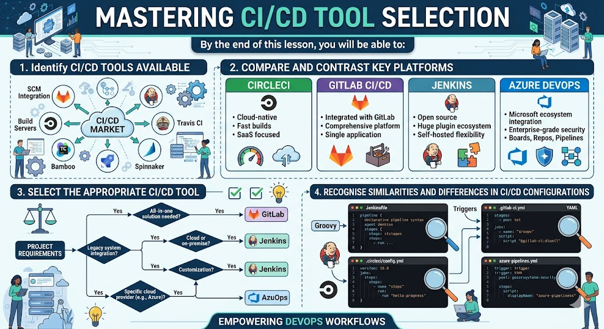

# [4.9] Tool Exploration - CI/CD Tools

## Lesson Overview

## Dependencies
- [Self Studies](./studies.md)
- [Lesson](./lesson.md)
- [Assignment](./assignment.md)

## Lesson Objectives
* **Identify** the three main types of CI/CD tools: platform-integrated, managed CI services and self-hosted
* **Explain** the trade-offs of each type of tool
* **Select** the right type of tool, and a tool within it, for a given use case
* **Build** a GitHub Actions workflow for the devops-demo project and **compare** it with the CircleCI workflow from Lesson 4.7

## Lesson Plan

| Duration | What | How or Why |
|----------|------|------------|
| 10 min | Warm up | Intro and lesson overview, recap CI concepts from Lesson 4.7 |
| 20 min | Part 1: CI/CD tool landscape | Three types of tools (platform-integrated, managed, self-hosted), how to choose |
| 10 min | Activity 1 - Tool matching discussion | Learners match tool types to scenarios |
| 60 min | Part 2: GitHub Actions hands-on | Learners download devops-demo `v4.9.0`, push to a new `devops-demo-lesson-4.9` repo and add a build-test-publish workflow |
| 15 min | Part 3 + Activity 2: CircleCI vs GitHub Actions | Compare the two configs, break and fix the pipeline |
| 25 min | Part 4: Tool selection activity | Small groups work through 4 company scenario cards and justify their choice |
| 10 min | Part 5: When to switch CI/CD tools | Signs to switch, migration considerations |
| 10 min | Recap and wrap up | Key takeaways, Q&A |
| **Total** | | **160 min - allows ~20 min buffer** |
